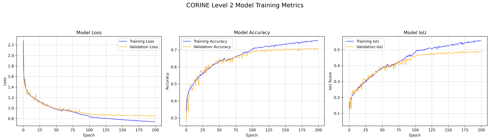
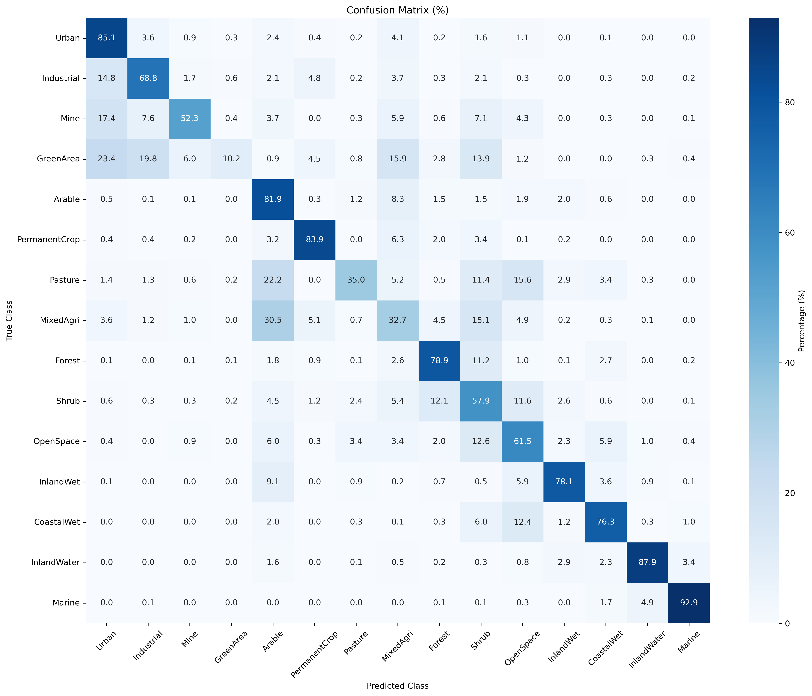

# CORINE Level-2 Land Cover Classification from Sentinel-2 Images Using U-Net

[](https://github.com/eapeker/corine-unet-model/actions/workflows/tests.yml)

Code accompanying the article:

> Peker, E. A., Çalışkan, M., Bora, E., İnan, Ç., & Uçaner, M. E. (2025).
> CORINE Level-2 Land Cover Classification from Sentinel-2 Images Using U-Net Deep Learning Model.
> *International Journal of Environment and Geoinformatics*, 12(2), 34–44.
> https://doi.org/10.26650/ijegeo.1644726

## Purpose

Semantic segmentation of Sentinel-2 imagery into the 15 CORINE Land Cover Level-2 classes
using a U-Net-based deep learning model.

## Study area and data

- **Study area:** 92 working units across Türkiye, covering about 12,000 km²
  (about 1.5% of the country) and representing all 15 Level-2 classes.
- **Images:** Sentinel-2 RGB, NIR and SWIR bands (6 bands), acquired June–September 2018
  (the CORINE 2018 production period).
- **Labels:** CORINE Land Cover 2018, Level 2 (15 classes, one-hot encoded).
- **Samples:** 2,815 patches of 256 × 256 pixels.
- The dataset is not publicly available.


## Method

- U-Net encoder–decoder with residual convolutional blocks
- Spatial attention after each encoder stage
- Atrous Spatial Pyramid Pooling (ASPP) at the bottleneck
- Loss: 0.5 × categorical cross-entropy + 0.5 × Jaccard loss
- Per-band 2–98 percentile normalization
- Stratified train/test split by dominant patch class, then a train/validation split
- Training: up to 200 epochs, batch size 8, custom learning-rate schedule,
  early stopping and ReduceLROnPlateau on validation loss

## Results (from the paper)

Mean IoU: **0.5018**

| | Class | IoU |
|---|---|---|
| Best | Marine waters | 0.9077 |
| | Inland waters | 0.8323 |
| | Permanent crops | 0.6855 |
| Most difficult | Artificial, non-agricultural vegetated areas | 0.1273 |
| | Pastures | 0.1760 |





## How to run

Requires Python 3.8–3.11.

1. Install dependencies:
   ```bash
   pip install -r requirements.txt
   ```
2. Set the data paths in `config.yaml`:
   - `data.images_path`: image patches, shape (N, 256, 256, 6)
   - `data.labels_path`: one-hot labels, shape (N, 256, 256, 15)
3. Train and evaluate:
   ```bash
   python main.py --config config.yaml
   ```
   or use `scripts/train.sh` (Linux/macOS) or `scripts/train.ps1` (Windows).

`config.yaml` also holds the output folder, epochs, batch size, seed, split sizes,
early stopping patience and learning-rate settings. The default values are the same as in the original script.
Outputs are written to `outputs/`: `best_model.keras`, `training_metrics.png` and
`confusion_matrix_percentage.png`.

## Tests

```bash
pytest
```

One test checks the model output shape; the other runs one training epoch end to end on
random data. Tests run on every push with GitHub Actions.

## Reproducibility

The exact code used for the paper is available at the `paper-version` tag
(`git checkout paper-version`).

## Repository structure

```
corine-unet-model/
├── main.py                 # entry point (--config)
├── config.yaml             # paths, training and learning-rate settings
├── src/corine_unet/
│   ├── data.py             # loading, cleaning, normalization, splitting
│   ├── model.py            # U-Net with spatial attention and ASPP
│   ├── losses.py           # Jaccard + cross-entropy loss, mean IoU metric
│   ├── train.py            # learning-rate schedule, callbacks, training curves
│   └── evaluate.py         # per-class metrics, confusion matrix
├── scripts/                # train.sh, train.ps1
├── tests/                  # pytest tests
├── figures/                # study area map, training curves, confusion matrix
└── requirements.txt
```

## Citation

```bibtex
@article{peker2025corine,
  title   = {CORINE Level-2 Land Cover Classification from Sentinel-2 Images Using U-Net Deep Learning Model},
  author  = {Peker, Emin Atabey and Çalışkan, Murat and Bora, Eser and İnan, Çiğdem and Uçaner, M. Erkan},
  journal = {International Journal of Environment and Geoinformatics},
  volume  = {12},
  number  = {2},
  pages   = {34--44},
  year    = {2025},
  doi     = {10.26650/ijegeo.1644726}
}
```

## Usage

Code accompanying the article. For reuse, please contact the author.

## Contact

eminatabeypeker@gmail.com
